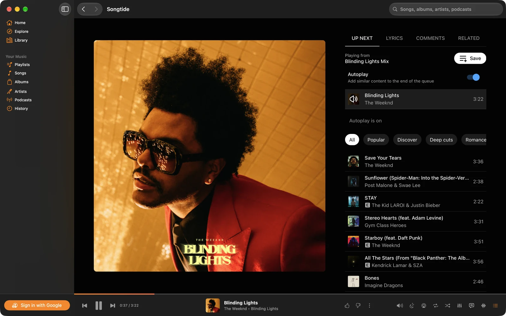
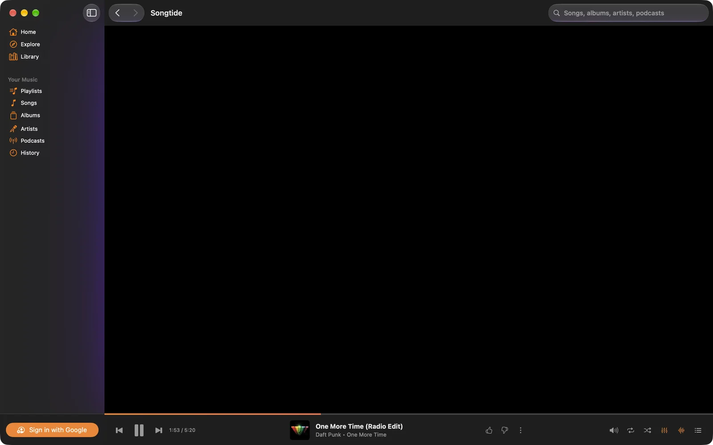
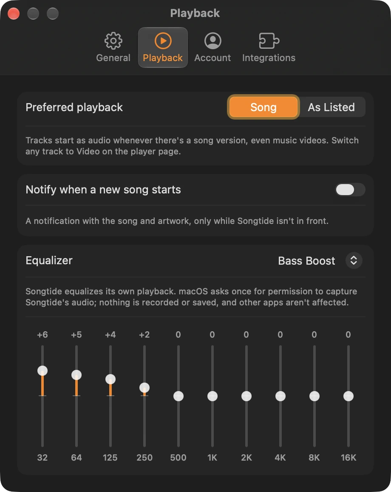

# Songtide

A native Mac app for YouTube Music. Free, signed and notarized by Apple.

**Download:** [songtide.dcoded.dev](https://songtide.dcoded.dev) · or `brew install --cask dcoded-dev/tap/songtide`



Songtide is an independent app. It is not affiliated with, endorsed by or sponsored by Google or YouTube.

## What it adds to YouTube Music

- A Mac sidebar, toolbar, menus and player bar in place of the website's own
- A 10-band equalizer that applies only to Songtide's playback
- A visualizer (MilkDrop presets, through [Butterchurn](https://github.com/jberg/butterchurn)), with synced lyrics over it
- Synced lyrics in a floating window, from [LRCLIB](https://lrclib.net)
- A menu bar mini player, a desktop widget and a Control Center control
- Media keys and Now Playing, track notifications, an audio output picker and a sleep timer
- Shortcuts and Siri actions
- Last.fm scrobbling and Discord status (both optional and off by default)
- Automatic updates

Requires macOS 15 or later. You sign in with your own Google account inside the app; what you can play depends on your YouTube Music account.

| Visualizer | Equalizer |
| --- | --- |
|  |  |

## How it works

The YouTube Music website runs in a `WKWebView` with its own navigation and player hidden. The sidebar, toolbar, player bar, menus, mini player and Settings are SwiftUI and AppKit, and talk to the page through [`Songtide/Web/bridge.js`](Songtide/Web/bridge.js). The equalizer and visualizer capture the app's own audio with a Core Audio process tap.

## Build

Requires a recent Xcode and [XcodeGen](https://github.com/yonaskolb/XcodeGen).

```bash
xcodegen generate
xcodebuild -scheme Songtide -derivedDataPath build build
open build/Build/Products/Debug/Songtide.app
```

`project.yml` signs with DCODED's team; set `DEVELOPMENT_TEAM` to your own to build.

Last.fm needs an API key. Without one the app builds and runs, and Last.fm is unavailable. To enable it, copy `Config/Secrets.example.xcconfig` to `Config/Secrets.xcconfig` and fill it in.

## Debugging

Debug builds log bridge traffic to stderr when run with `YTM_DEBUG=1`, and `scripts/ytm-eval '<js>'` evaluates JavaScript in the running app's page.

## Repository layout

- `Songtide/` the app
- `SongtideWidget/` the widget and Control Center control
- `Shared/` code used by both
- `site/` the website at songtide.dcoded.dev, including release notes and the update feed
- `worker/` the site's Cloudflare Worker, which keeps anonymous daily counts of downloads and update checks (described in the [privacy policy](https://songtide.dcoded.dev/privacy/))
- `scripts/` release and debugging scripts

## Privacy

The app has no analytics or tracking. See the [privacy policy](https://songtide.dcoded.dev/privacy/) for the details, including the anonymous counts above.

## License

[GPL-3.0](LICENSE). Songtide was developed privately from September 2026 and open-sourced at version 1.1.20.

Butterchurn and its presets, in `Songtide/Web/Visualizer` and `site/vendor`, are under their own licenses.
